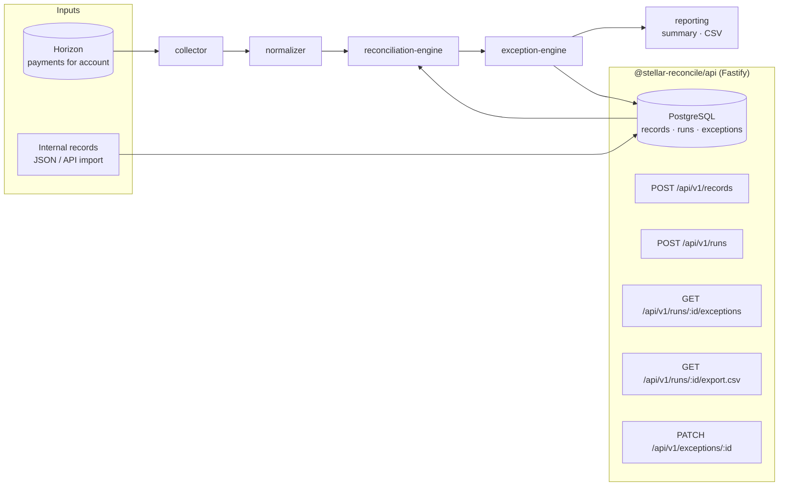

# stellar-reconcile

**Accounting-grade reconciliation infrastructure for Stellar assets and transactions.**

[](https://github.com/StellarOpenInfrastructure/stellar-reconcile/actions/workflows/ci.yml)
[](https://github.com/StellarOpenInfrastructure/stellar-reconcile/actions/workflows/security.yml)
[](LICENSE)
[](#roadmap)
[](docs/drips-wave.md)

> Prove that what happened on Stellar matches what your books say happened —
> per transaction, per asset, per balance, per fee — and turn every difference
> into a tracked exception.

---

## Problem

Anchors, payment companies, exchanges and treasuries run a business ledger
_and_ a Stellar account. Finance teams need to close the books, auditors need
evidence, and operations need to find the one payout that went out twice. Today
this is done with spreadsheets, Horizon CSV exports and floating-point
arithmetic that rounds stroops away.

## Solution

`stellar-reconcile` is a reconciliation engine and API:

1. **Collect** on-chain activity for an account (Horizon today; RPC/indexer
   adapters are pluggable).
2. **Normalize** it into signed, exact-precision entries.
3. **Import** your internal records (invoices, payouts, ledger lines).
4. **Reconcile**: three-pass transaction matching, balance roll-forward, asset
   totals, fee totals, duplicate detection.
5. **Track exceptions** with deterministic ids, severities, statuses and notes
   that survive re-runs.
6. **Report**: JSON summaries and CSV exports for finance tooling.

All arithmetic uses `bigint` at Stellar's 7-decimal precision — never floats.

## Why Stellar

- Stellar has a canonical, ordered, immutable ledger with cheap, fast
  finality: the "chain side" of a reconciliation is unambiguous.
- Payment-focused operations (`payment`, path payments, `create_account`) map
  cleanly to accounting entries.
- Anchors and SEP-based businesses (SEP-6/24/31) generate exactly the
  invoice/payout records this engine matches.
- Fees are explicit per transaction, so fee reconciliation is exact.

## Architecture



### Stellar infrastructure consumed

| Component                     | Uses                                                    | Notes                                                                                                                                                                                  |
| ----------------------------- | ------------------------------------------------------- | -------------------------------------------------------------------------------------------------------------------------------------------------------------------------------------- |
| `HorizonCollector`            | **Horizon** `/accounts/{id}/payments?join=transactions` | Stellar RPC does not index classic payment history by account and retains only a short window, so Horizon remains the practical source. An indexer-backed collector is a roadmap item. |
| `collectBalances`             | Horizon `/accounts/{id}`                                | balance snapshots                                                                                                                                                                      |
| engine, exceptions, reporting | none                                                    | pure, deterministic                                                                                                                                                                    |

No custom indexer is built; the `Collector` interface lets you plug in one you
already run.

## Features

- ✅ Exact decimal arithmetic (`bigint`, 7 decimals)
- ✅ Horizon collector with paging; static collector for tests/imports
- ✅ Normalization of payments, path payments, `create_account`, fees
- ✅ Transaction matching: tx hash → memo+amount → amount within window
- ✅ Balance reconciliation (opening + activity vs snapshot)
- ✅ Asset reconciliation (in/out per asset, both sides)
- ✅ Fee reconciliation
- ✅ Duplicate detection (external refs, near-duplicate payouts, double
  collection)
- ✅ Deterministic exception ids; status/notes survive re-runs
- ✅ CSV export, JSON summaries
- ✅ Fastify API, OpenAPI, pagination, request ids, `/health`, `/ready`
- ✅ PostgreSQL persistence with SQL migrations; in-memory mode for dev
- ⏳ Soroban token (SEP-41) events collector — roadmap
- ⏳ Scheduled runs and webhooks — roadmap
- ⏳ Web UI — roadmap

## Repository structure

```
stellar-reconcile/
├── packages/core/src/
│   ├── collector/              # Collector interface, Horizon + static
│   ├── normalizer/             # Horizon records → ChainEntry
│   ├── ledger/                 # domain types, exact amounts
│   ├── reconciliation-engine/  # matcher, duplicates, balances, assets, fees
│   ├── exception-engine/       # exceptions + severity
│   └── reporting/              # summaries, CSV
├── backend/                    # @stellar-reconcile/api (Fastify)
│   └── src/repository/         # InMemoryRepository, PostgresRepository
├── database/
│   ├── migrations/             # append-only SQL
│   ├── seeds/
│   └── schema/README.md        # ER diagram
├── scripts/                    # migrate.ts, export-openapi.ts
├── tests/                      # Postgres integration test (opt-in)
├── docs/                       # architecture, api, guides, security, adr, drips-wave
├── docker-compose.yml, backend/Dockerfile, Makefile
```

No `frontend/` yet — finance teams consume CSV/JSON first; a review UI is on
the roadmap. No `contracts/` — reconciliation is off-chain by nature. No Redis
— nothing in the scaffold needs a cache or queue.

## Requirements

- Node.js ≥ 22, pnpm ≥ 10
- PostgreSQL 16 (or Docker) for persistent mode

## Installation

```bash
git clone https://github.com/StellarOpenInfrastructure/stellar-reconcile
cd stellar-reconcile
make setup
cp .env.example .env
```

## Configuration

| Variable                        | Default           | Purpose                       |
| ------------------------------- | ----------------- | ----------------------------- |
| `DATABASE_URL`                  | unset → in-memory | PostgreSQL connection         |
| `STELLAR_NETWORK`               | `testnet`         | selects Horizon URL           |
| `STELLAR_HORIZON_URL`           | preset            | override / custom network     |
| `SEVERITY_MEDIUM/HIGH/CRITICAL` | 100/1000/10000    | exception severity thresholds |
| `PORT`                          | 4020              |                               |

## Development

```bash
make dev        # API on http://localhost:4020, docs at /docs
make test       # unit + API tests (in-memory)
make test-db    # also runs the Postgres integration test
make lint && make typecheck && make build
make migrate    # apply SQL migrations to DATABASE_URL
```

## Testing

- Core: amounts, normalizer, matcher, duplicates, balances/assets/fees,
  exception derivation, CSV.
- API: full request flow with an injected static collector.
- Postgres repository: integration test that runs only when `DATABASE_URL` is
  set; CI provides a service container.

## API

| Method  | Path                          | Purpose                                           |
| ------- | ----------------------------- | ------------------------------------------------- |
| `POST`  | `/api/v1/records`             | import internal records (upsert)                  |
| `GET`   | `/api/v1/records`             | list records by account/range                     |
| `POST`  | `/api/v1/runs`                | run a reconciliation                              |
| `GET`   | `/api/v1/runs`                | list runs (paginated)                             |
| `GET`   | `/api/v1/runs/:id`            | run summary                                       |
| `GET`   | `/api/v1/runs/:id/exceptions` | exceptions (filter by status/severity, paginated) |
| `GET`   | `/api/v1/runs/:id/export.csv` | CSV export                                        |
| `PATCH` | `/api/v1/exceptions/:id`      | acknowledge / resolve / ignore with a note        |

See [docs/api/README.md](docs/api/README.md) and
[docs/api/openapi.json](docs/api/openapi.json).

## SDK

The core package is the SDK for in-process use:

```ts
import {
  reconcile,
  deriveExceptions,
  exceptionsToCsv,
  HorizonCollector,
} from "@stellar-reconcile/core";

const collector = new HorizonCollector({ horizonUrl: "https://horizon-testnet.stellar.org" });
const { entries } = await collector.collectEntries(account, { from, to });
const result = reconcile({ account, entries, records });
const exceptions = deriveExceptions(result);
console.log(exceptionsToCsv(exceptions));
```

An HTTP client SDK is a Drips Wave issue.

## Contracts

Not applicable.

## Deployment

```bash
make docker-up     # api + postgres; migrations applied on first init
```

Run `make migrate` against production databases as part of your deploy
pipeline; the API never auto-migrates.

## Security

See [SECURITY.md](SECURITY.md) and [docs/security/overview.md](docs/security/overview.md).
The API has no authentication in this scaffold; keep it on a private network.

## Threat model

| Threat                             | Mitigation                                               |
| ---------------------------------- | -------------------------------------------------------- |
| Wrong chain data from Horizon      | Horizon is trusted; run your own or a reputable provider |
| Float rounding hides discrepancies | all arithmetic in `bigint`                               |
| Re-runs erase operator work        | deterministic exception ids; status/notes preserved      |
| Oversized imports                  | body limit 5 MB, max 5000 records per request            |
| SQL injection                      | parameterised queries via `postgres` tagged templates    |
| Unauthorised access                | none in scaffold — see roadmap                           |

## Roadmap

1. API-key auth and audit trail of exception changes
2. Soroban token event collector (SEP-41 `transfer` events via RPC)
3. Indexer-backed collector interface (e.g. Galexie/Hubble exports)
4. Scheduled runs, webhooks on new critical exceptions
5. Review UI
6. Multi-account and multi-currency close reports

Backlog: [docs/drips-wave.md](docs/drips-wave.md).

## Contributing

See [CONTRIBUTING.md](CONTRIBUTING.md).

## Drips Wave contribution areas

| Area       | Examples                                                              |
| ---------- | --------------------------------------------------------------------- |
| Collectors | Soroban events, indexer adapters, effects-based account merge amounts |
| Matching   | configurable strategies, tolerance windows, fuzzy memos               |
| Reporting  | XLSX, PDF close reports, per-asset statements                         |
| API        | auth, webhooks, SDK client                                            |
| Docs       | finance-team guides, sample datasets                                  |

## License

Apache-2.0.

## Disclaimer

Initial scaffold. Verify results against your own controls before relying on
them for financial close or audit evidence.
