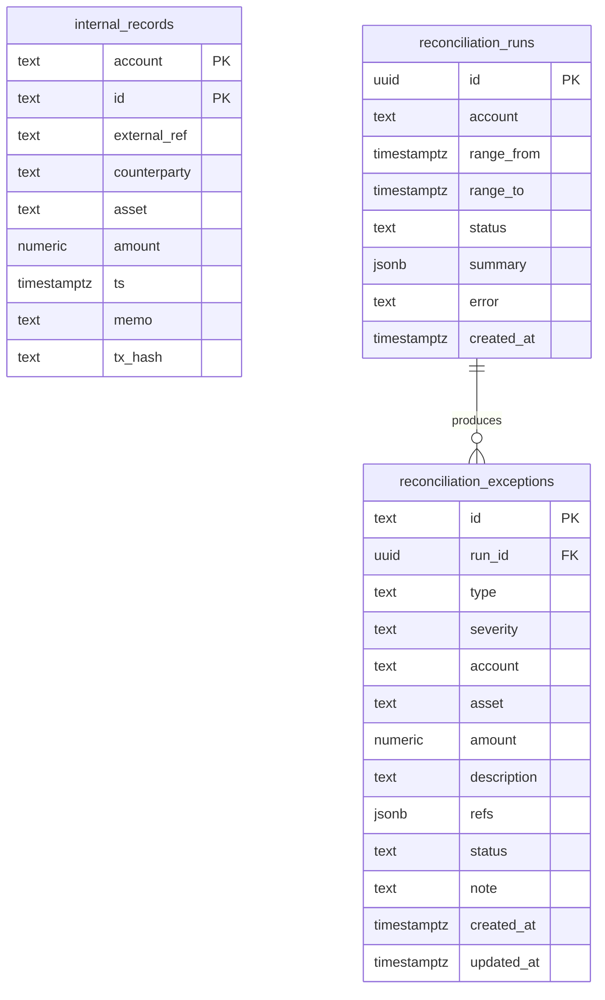

# Schema

- Amounts are `numeric(30,7)` — Stellar's native precision. Never use floats.
- Exception ids are deterministic (`TYPE:refs`) so re-running a range does
  not create duplicates; status and notes survive re-runs.
- Chain entries are **not** stored: they are re-collected per run. Caching
  them is a roadmap item (see `docs/drips-wave.md`).
- Migrations are plain SQL files applied in filename order and recorded in
  `schema_migrations`. Never edit an applied migration; add a new file.
