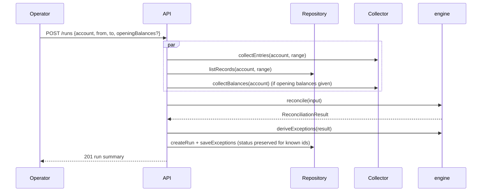

# Architecture

## Two-sided model

| Side     | Type             | Source                       |
| -------- | ---------------- | ---------------------------- |
| Chain    | `ChainEntry`     | `Collector` → `normalizer`   |
| Business | `InternalRecord` | API import (`POST /records`) |

Both use the same sign convention (positive credits the account) and the same
asset key format (`native`, `CODE:ISSUER`, `contract:C...`).

## Reconciliation run

## Matching strategy

1. `tx_hash` — record carries the hash; amount and asset must also agree.
2. `memo_amount` — same memo, asset and amount.
3. `amount_window` — same asset and amount within `matchWindowSeconds`
   (default 24 h); counterparties must agree when both sides have one;
   closest timestamp wins; confidence decays with distance.

Each pass consumes matched items so nothing is matched twice. Fee entries are
excluded from matching but included in balance roll-forward.

## Exceptions

Exception ids are `TYPE:ref|ref…` and therefore stable across runs for the
same underlying discrepancy. `saveExceptions` upserts and keeps `status` and
`note`, so operator work is not lost when a range is reconciled again.

## Persistence

`Repository` is the persistence boundary. `InMemoryRepository` backs tests and
local development; `PostgresRepository` is the production implementation. The
API never creates tables — `scripts/migrate.ts` applies
`database/migrations/*.sql` in order.

## Extension points

- `Collector` — add RPC/indexer-backed sources.
- Normalizers — add Soroban events (`contract_transfer` kind exists already).
- Severity thresholds — configured via environment.
